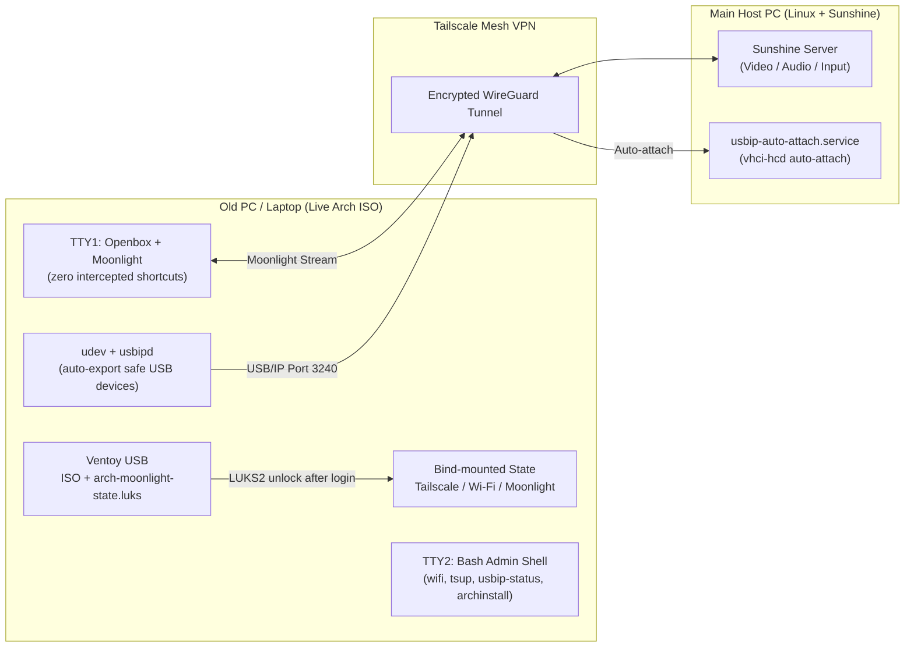

# Arch Moonlight ThinClient ISO

[](https://archlinux.org/)
[](https://moonlight-stream.org/)
[](https://tailscale.com/)
[](LICENSE)

Turn any old `x86_64` PC or laptop (2–4 GB RAM+) into a **stateless, encrypted, zero-maintenance Moonlight thin client** booting straight from a **Ventoy** USB drive — complete with **Tailscale** networking and **automatic hot-plug USB/IP passthrough** to your main host PC (running [Sunshine](https://github.com/LizardByte/Sunshine)).

---

## Why This Project?

Instead of installing and maintaining a full desktop OS on an aging laptop just to stream your main workstation or gaming rig:

- **Immutable live OS**: Read-only Arch Linux SquashFS (`copytoram=n` saves ~1 GB of RAM on low-memory machines). Nothing degrades or drifts over time.
- **Zero plaintext secrets on the USB stick**: Password-protected login (no autologin) + a **128 MB LUKS2 encrypted container** (`arch-moonlight-state.luks`) stored alongside the ISO on Ventoy. If you lose the USB drive, your Wi-Fi passwords, Tailscale identity, and Moonlight pairing keys remain encrypted.
- **Distraction-free fullscreen Moonlight**: Boots TTY1 into a bare-bones X11 + Openbox kiosk session with **zero intercepted keybindings** — every shortcut (`Alt+Tab`, `Super`, function keys) passes directly into your remote desktop.
- **Seamless USB/IP over Tailscale**: Plug a flash drive, gamepad, DAC, or peripheral into the old PC and it automatically binds via `usbip` and attaches to your host PC over Tailscale — while safely ignoring the Ventoy boot drive, USB hubs, local keyboard/mouse, and USB network adapters.

---

## Architecture



---

## Key Features

- **Minimalist & Universal Hardware Support**: Includes Mesa, Intel/AMD/Nouveau/VESA drivers, VA-API hardware decoding (`libva-intel-driver`, `intel-media-driver`, `libva-mesa-driver`), and lightweight PipeWire audio.
- **LUKS2 Encrypted Persistence**: Mounted only after login and cleanly unmounted/locked on shutdown (`thin-lock-state.service`). Persists only:
  - `/var/lib/tailscale` — Tailscale node identity
  - `/etc/NetworkManager/system-connections` — saved Wi-Fi / Ethernet profiles
  - `~/.config/Moonlight Game Streaming Project` — Sunshine pairing & client preferences
  - `/etc/thinclient/custom` — custom USB/IP ignore rules
- **Safe ISO Rebuilds**: Re-running `./build-and-deploy.sh` updates the ISO on Ventoy while leaving your existing `arch-moonlight-state.luks` container completely untouched.
- **Interactive Bilingual Builder**: Prompts at startup for **English (default)** or **French** (`Français`) and lets you choose the ISO keyboard layout (`us`, `fr`, `de`, `uk`, etc.) for both console and X11.
- **Built-in Rescue / Admin Shell (`TTY2`)**: Switch anytime with `Ctrl+Alt+F2` for `nmtui`, `tailscale`, `usbip`, `ssh`, `htop`, `tmux`, and even `archinstall`.

---

## Requirements

- **Build Machine**: Arch Linux or Arch-based distro (Arch, EndeavourOS, CachyOS, etc.) with `sudo` access.
- **USB Drive**: Formatted with [Ventoy](https://www.ventoy.net/) (auto-detected at `/run/media/$USER/Ventoy`, or copy the generated `.iso` manually).
- **Host PC**: Running [Sunshine](https://github.com/LizardByte/Sunshine) and [Tailscale](https://tailscale.com/). For automatic USB/IP attachment, an Arch-based Linux host (or any Linux host with `usbip` + `vhci-hcd`).
- **Thin Client**: Any `x86_64` PC/laptop (BIOS or UEFI), 2 GB+ RAM recommended.

---

## Quick Start

### 1. Build & Deploy the ISO

```bash
git clone https://github.com/Cbampeta/arch-moonlight-iso.git
cd arch-moonlight-iso
chmod +x build-and-deploy.sh host-setup/install-host-usbip.sh
./build-and-deploy.sh
```

The interactive script will:
1. Ask your preferred language (**English** or **French**) and ISO keyboard layout (`us`, `fr`, etc.).
2. Install build dependencies (`archiso`, `usbip`, `cryptsetup`, `openssl`).
3. Ask for the ISO login password (used for `thin` and `root`).
4. Build the custom Arch Linux ISO in `out/`.
5. Copy `arch-moonlight-thinclient.iso` to your mounted Ventoy USB drive and configure `ventoy/ventoy.json` (`VTOY_LINUX_REMOUNT`).
6. Create the 128 MB LUKS2 container `arch-moonlight-state.luks` on Ventoy (or keep your existing one intact).
7. Optionally install and enable the `usbip-auto-attach.service` daemon on your host PC.

> [!TIP]
> To install the USB/IP host receiver separately on another Linux host, copy `host-setup/` and run `./host-setup/install-host-usbip.sh`.

---

### 2. First Boot on the Thin Client

1. Boot the old PC from your **Ventoy** USB drive and select **`arch-moonlight-thinclient.iso`**.
2. On **TTY1**, log in as `thin` with the password you set during the build.
3. Enter your **LUKS2 passphrase** to unlock encrypted persistence.
4. Moonlight launches fullscreen. For first-time network & Tailscale setup:
   - Press **`Ctrl+Alt+F2`** and log in as `thin`.
   - Run `wifi` (`nmtui`) to connect to Wi-Fi (or plug in Ethernet).
   - Run `tsup` (`sudo tailscale up`) to authenticate the thin client on your Tailscale network (hostname: `arch-thinclient`).
   - Switch back to Moonlight with **`Ctrl+Alt+F1`** and pair your host PC using its Tailscale IP or MagicDNS name.
5. **Done!** Everything is saved inside `arch-moonlight-state.luks`. On every subsequent boot, just log in and unlock LUKS — Wi-Fi, Tailscale, Moonlight, and USB/IP reconnect automatically.

---

## USB/IP Auto-Passthrough & Safety Exclusions

When a USB device is plugged into the thin client, a `udev` rule triggers `usbip-auto-export.sh` which automatically binds eligible devices to `usbip-host`. On your host PC, `usbip-auto-attach.service` polls `arch-thinclient` over Tailscale and attaches exported devices locally via `vhci-hcd`.

### Automatically Protected (Never Exported)

To prevent locking yourself out or crashing the live OS, the following devices are **always skipped**:
- **Ventoy / Boot & Mounted Storage**: Any block device currently mounted, held by `device-mapper` (e.g. Ventoy `dm-linear`), or labeled `Ventoy` / `VTOYEFI`.
- **USB Hubs** (USB class `09`).
- **Local Keyboards & Mice** (HID Boot Keyboard `03/01` and HID Boot Mouse `03/02`).
- **USB Network Adapters** (Wi-Fi dongles, USB Ethernet, phone tethering).

### Custom Exclusions

To prevent a specific USB device from being exported, add its `vendor_id:product_id` (from `lsusb`) to the persistent ignore file on the thin client:

```bash
# Example on the thin client (persisted inside LUKS2):
echo "046d:c52b" | sudo tee -a /etc/thinclient/custom/usbip-ignore.conf
```

---

## Useful Commands

### On the Thin Client (`Ctrl+Alt+F2`)

| Command | Description |
| :--- | :--- |
| `wifi` | Open `nmtui` to configure Wi-Fi / Ethernet |
| `ts` | Show Tailscale status (`tailscale status`) |
| `tsup` | Connect / authenticate Tailscale (`sudo tailscale up`) |
| `usbip-status` | Show `usbipd` status, local USB devices, and recent export/skip logs |
| `usbip-scan` | Force a rescan of already-plugged USB devices |
| `unlock` | Manually unlock and mount the LUKS2 persistence container |
| `archinstall` | Launch the official Arch Linux installer if needed |

### On the Host PC

| Command | Description |
| :--- | :--- |
| `systemctl status usbip-auto-attach.service` | Check the host USB/IP receiver daemon |
| `journalctl -u usbip-auto-attach.service -f` | Follow live USB/IP attach logs |
| `usbip port` | List currently attached remote USB devices |
| `/etc/usbip-auto-attach.conf` | Edit target Tailscale hostname/IP (`THINCLIENT_HOST`) or poll interval |

---

## Project Structure

```text
.
├── build-and-deploy.sh          # Interactive ISO builder, Ventoy deployer & LUKS2 initializer
├── packages.x86_64              # Archiso package list (minimalist, universal drivers, Moonlight)
├── host-setup/                  # Host-side automatic USB/IP receiver (systemd service)
│   ├── install-host-usbip.sh
│   ├── usbip-auto-attach.conf
│   ├── usbip-auto-attach.service
│   ├── usbip-auto-attach.sh
│   └── usbip-client.conf
└── overlay/                     # Files overlaid onto the live ISO root filesystem
    ├── etc/
    │   ├── hostname
    │   ├── locale.conf
    │   ├── vconsole.conf
    │   ├── X11/xorg.conf.d/00-keyboard.conf
    │   ├── NetworkManager/conf.d/10-no-rand-mac.conf
    │   ├── modules-load.d/usbip.conf
    │   ├── sudoers.d/10-thin
    │   ├── systemd/system/
    │   │   ├── thin-lock-state.service
    │   │   └── usbip-initial-scan.service
    │   ├── sysusers.d/thin.conf
    │   ├── thinclient/
    │   │   ├── openbox-rc.xml
    │   │   └── usbip-ignore.conf
    │   └── udev/rules.d/99-usbip-auto.rules
    ├── home/thin/
    │   ├── .bash_profile
    │   └── .bashrc
    └── usr/local/bin/
        ├── thin-lock-state
        ├── thin-unlock-state
        ├── thin-xsession
        ├── usbip-auto-export.sh
        ├── usbip-scan
        └── usbip-status
```

---

## Security Notes

- **No default passwords**: You set the `thin`/`root` password interactively at build time; it is hashed with SHA-512 (`openssl passwd -6`) and never committed to git.
- **No autologin**: The releng root autologin drop-in is explicitly removed during the build.
- **Tailscale ACLs**: Consider restricting TCP port `3240` (USB/IP) in your Tailscale ACLs so only your host PC can attach USB devices from `arch-thinclient`.

---

## License

This project is licensed under the [MIT License](LICENSE).
